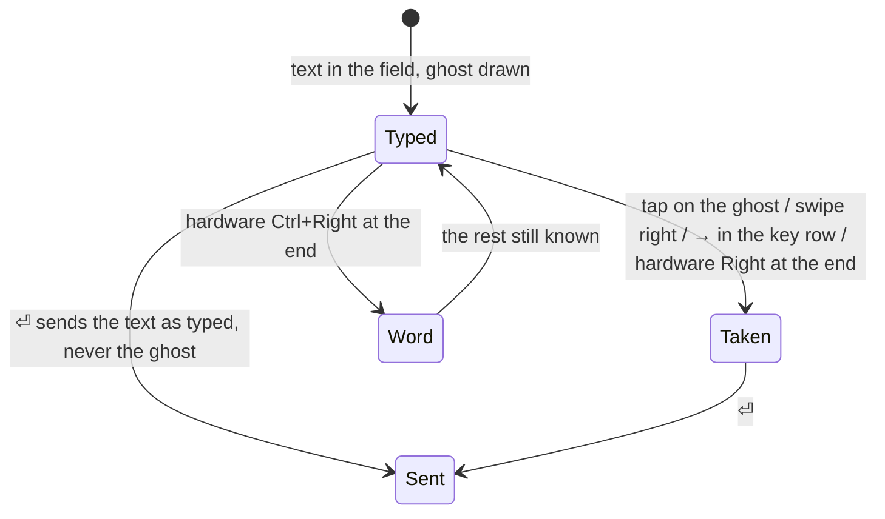

# Feature: a held tile is drawn scaled, and `→` takes the ghost

> Status: written 2026-11-09 from the owner's report in the console (a
> screenshot of a pane reading `62×48 held` with every row cut twice,
> and no way to take the line's ghost from the key row). Waiting for
> the owner's approval; no code before it.

## 1. Goal

Two problems in the pane view, both on the phone alone.

**The held tile.** The screenshot shows a Claude pane alone in the view
with its header reading `62×48 held` in the alert colour, and the
screen a mess: every row the host had already cut at 62 columns is cut
again at the 49 the tile fits, so a line of the pane takes two rows and
the indentation is lost. The width is not miscalculated: the phone fits
49 columns at the *text* setting and asked for 49, and the host kept
62. The pane's tmux window holds three panes side by side, and the host
never lets a fit take a neighbour under its floor of 20 columns: three
floors and two dividers are 62, so the window grows to 62 and the
zoomed pane with it (`ResizeWindow` in the core, `LeastLayout`). The
guideline says what the tile should do then (`docs/ui-guideline.md`
§1.4, the *fit* row): a tile whose size the host would not give *says
held in its header and is drawn scaled to its box*. The web client does
that. The phone says held and then re-wraps the host's screen at its
own columns anyway, because the drawing only asks whether fit is on,
not whether the host took it.

After this change a held tile is drawn like a tile with fit off: the
text shrinks until the host's columns fit the tile, nothing is
re-wrapped, pinch still zooms. The header keeps `62×48 held`. What the
phone asks of the host does not change: it keeps asking for the cells
that fit at the *text* setting, so a scaled tile never asks for its
scaled columns (which would be the host's, match, unscale, and ask for
49 again, round and round).

**The ghost from the key row.** While a shell pane is typed into, the
rest of a known line is drawn dim after the text in the field. The
guideline's Android column takes it with a tap on it or a swipe right
across the field, and `Right` or `Ctrl+Right` on a hardware keyboard.
The owner reached for `→` in the key row, which sends `Right` to the
pane as a console key, and the ghost stays. The hardware keyboard's
`Right` does not take it either: the field consumes the arrow to move
its caret, so the view's key handler never sees it.

After this change `→` in the key row takes the ghost into the field,
whole, while one is drawn, and sends `Right` to the pane as now when
none is; and on a hardware keyboard, with the line focused and the
caret at its end, `Right` takes the ghost whole and `Ctrl+Right` its
first word, as the guideline already says. Nothing is sent by taking a
ghost; `⏎` sends the text as typed, as before.

Out of scope: the hub's floor (a pane cannot be narrower than its
window's panes allow; the owner can lower the *text* setting or thin
the window on the host), a `Ctrl+→` key in the key row (there is
none), and the completion row above the line, which takes with a tap
and is not touched.

## 2. Design

### 2.1 The held tile is drawn scaled

`PaneTile` already decides *held* for its header, from three cases:
another tile of the window carries the fit (`shared`), a one-window fit
whose pane is not the size the layout gave it (`windowFit` and
`expected`), or a size this phone sent that the host did not keep
(`state.fitKey` against the pane's size). That value is hoisted above
the screen's `BoxWithConstraints` and goes into one pure decision,
`TileScale.of(...)` in `ui/TileFit.kt`, which the box then draws by:

| input | what it is |
|---|---|
| `fitting` | fit on and the pane writable |
| `held` | the header's held, as above |
| `reflow` | the *reflow* setting |
| `textSp` | the *text* setting |
| `fitSp` | the size at which the pane's columns fill the tile's width |
| `zoom` | the pinch factor |

and gives:

| output | fit on, host took it | fit on, held | fit off | reflow (fit off or held) |
|---|---|---|---|---|
| `drawSp` | `textSp × zoom` | `min(textSp, fitSp) × zoom` | `min(textSp, fitSp) × zoom` | `textSp × zoom` |
| `cols` (the rows are cut at) | the tile's columns | the pane's | the pane's | the tile's |
| `cellSp` (the fit is measured at) | `textSp × zoom` | `textSp × zoom` | `textSp × zoom` | `textSp × zoom` |

`visibleCols` and `visibleRows`, which go to `onMeasured` (the
one-window layout) and to `model.fit`, are computed from `cellSp`, as
today; only the drawing (`style`, `colPx` for the tap and the ghost,
`rows`) uses `drawSp`. The *reflow* setting keeps its meaning (the
rows re-wrapped to the tile instead of the pane being scaled), and now
applies to a held tile too, since a held tile is a tile the phone does
not size.

Held is never true between a fit sent and its answer: `fitKey` and the
pane's size are set together from the hub's answer, so the tile does
not blink scaled on every fit. The twenty-second re-send on drift stays
as it is; on a floor it is one request more and no change.

```mermaid
sequenceDiagram
    participant T as Tile (phone)
    participant H as Hub
    participant X as Host tmux
    T->>T: fits 49×48 at the text setting
    T->>H: POST /v1/panes/{a}/resize {cols:49, rows:48, scope:window, zoom:true}
    H->>X: resize-window -x 62 -y 48 (three panes at the floor of 20, two dividers)
    X-->>H: pane 62×48
    H-->>T: pane {width:62, height:48}
    T->>T: fitKey 49x48 ≠ 62×48: held
    T->>T: draws 62 columns at min(text, fit) sp, rows uncut; header "62×48 held"
    T->>T: keeps measuring 49×48 at the text setting; sends nothing new
```

### 2.2 `→` and the hardware `Right` take the ghost

`InputBar` computes the line's ghost and holds the key row, so the
change is local: the `Right` button's action becomes *take the ghost*
while `ghost` is not empty (the same `onGhost` the tap and the swipe
use: the text plus the ghost, caret at the end, the field focused),
and `model.key(key, "Right")` otherwise. The button keeps its label,
tint and place; nothing else in the row changes.

`Line` gets an `onPreviewKeyEvent` on the field: `Right` with no
modifier, or `Ctrl+Right`, while a ghost is drawn and the selection is
collapsed at the end of the text, takes the ghost whole, or its first
word (`Suggest.firstWord`), and is consumed; any other key, or a caret
elsewhere, goes on to the field as now. The decision is a pure
function, `Ghost.take(name, atEnd, ghost)`, so it is unit-tested with
the field out of the way. Direct typing's `Right` is untouched (it
sends the ghost as text to the pane, from the view's handler, as now).



The guideline is the shared table: the *accept the suggestion* row's
Android column gains "`→` in the key row (whole)", and the *console key
from an empty input line* row's Android column says the key row's `→`
takes the ghost while one is drawn. That edit goes to the core
repository in its own pull request before the key is bound here (§4 of
AGENTS.md).

## 3. Protocol and API changes

None. The same `POST /v1/panes/{address}/resize` with the same body;
taking a ghost sends nothing. Compatible.

## 4. Security analysis

- Nothing new crosses a trust boundary. The ghost's pool is unchanged
  (this phone's sent lines, commands the screen shows at a prompt, the
  command row's starters, the pane's directory names; never the hub,
  never another pane), and taking it puts text into the field, which
  the person still sends by hand through the same `type` request, cut
  and whitelisted as before.
- `→` without a ghost sends `Right` by name, as before, through the
  same whitelist; no new key name.
- Scaling is drawing only. The fit request and its cells do not change;
  a held tile sends nothing it did not send before.
- Nothing is logged. No new dependency.
- An attacker who controls the screen's text already controls the
  ghost's screen-command source; the change adds no way to send it
  without the person's action.

## 5. Privacy check

The plan, the tests and the screenshots use the test hub's synthetic
panes (`work/0.0`, `echo one two`). The owner's screenshot is not
committed; its content is described in words only.

## 6. Test plan

| # | Test | Kind | Expected |
|---|------|------|----------|
| 1 | `→` with no ghost drawn sends `Right` (the name) to the pane and nothing else; the whitelist is unchanged | unit (`InputTest`, existing keys) + UI | the key reaches the pane as `Right` |
| 2 | A ghost taken by `→` sends nothing: the pane's screen is unchanged until `⏎` | UI | no request before `⏎` |
| 3 | `TileScale.of`: fit on and the host took it: draw at `text × zoom`, cut at the tile's columns, measure at `text × zoom` | unit | as the table in §2.1 |
| 4 | `TileScale.of`: held: draw at `min(text, fit) × zoom`, cut at the pane's columns, measure at `text × zoom` (unchanged by the scaling) | unit | as the table |
| 5 | `TileScale.of`: fit off, with and without *reflow*; held with *reflow* | unit | as the table |
| 6 | `Ghost.take`: `Right` at the end takes whole, `Ctrl+Right` the first word, a caret not at the end or no ghost takes nothing, every other key takes nothing | unit | as §2.2 |
| 7 | FlowTest: the test hub's `work` window split into three panes side by side, the *text* setting at 24 so the tile fits under 62 columns; `work/0.0` opened alone: the header reads `62×<the tile's rows> held` (the floor), no row of the screen is cut (a row of 62 `-` printed by `echo` is one node), and the fit sent is the tile's cells, not 62 | UI, screenshots `held-scaled`, `held-row` | the pane's columns on one row each, scaled |
| 8 | FlowTest: `echo one two` sent, `echo o` typed, the ghost drawn; `→` in the key row: the field holds `echo one two`, the ghost is gone, nothing was sent; `⏎` sends it | UI, screenshots `ghost-right`, `ghost-right-sent` | as §2.2 |
| 9 | The existing `theGhostWordGoesOnFromALineSentBeforeAndATapTakesIt` and the fit, one-window and `held` steps keep passing | UI | unchanged |

Security tests first (1, 2). The e2e run is recorded as a test-run issue
with the logs and screenshots, as `docs/testing.md` says.

## 7. Documentation

- Core: `docs/ui-guideline.md` §1.6, the two rows named in §2.2 (its own
  pull request, first).
- `docs/features/pane-view.md`: the *fit* bullet (a held tile is drawn
  scaled to the tile, what it asks the host does not change, the floor
  as the usual cause), the *reflow* bullet (applies to a held tile too),
  the *suggestion* bullet (`→` in the key row; hardware `Right` and
  `Ctrl+Right` on the line).
- `docs/features/shell-helper.md`, *The ghost word*: `→` and the
  hardware keys on the line, and the sequence diagram's "tap on the
  ghost (or swipe right)" step gains `→`.
- This plan records its review and its run when done.

## 8. Implementation steps

1. Core pull request: the two guideline rows.
2. `TileScale.of` in `ui/TileFit.kt` with its unit tests (3, 4, 5).
3. `PaneTile`: hoist `held`, draw by `TileScale`, measure by `cellSp`.
4. `Ghost.take` with its unit tests (6); `Line` gets the preview key
   handler; `InputBar`'s `→` takes the ghost.
5. FlowTest steps 7 and 8; `scripts/ui-tests.sh` splits the `work`
   window into three panes for step 7 (and joins them back, so the
   steps after it keep their window).
6. Docs (§7), the run, the test-run issue, the pull request.
