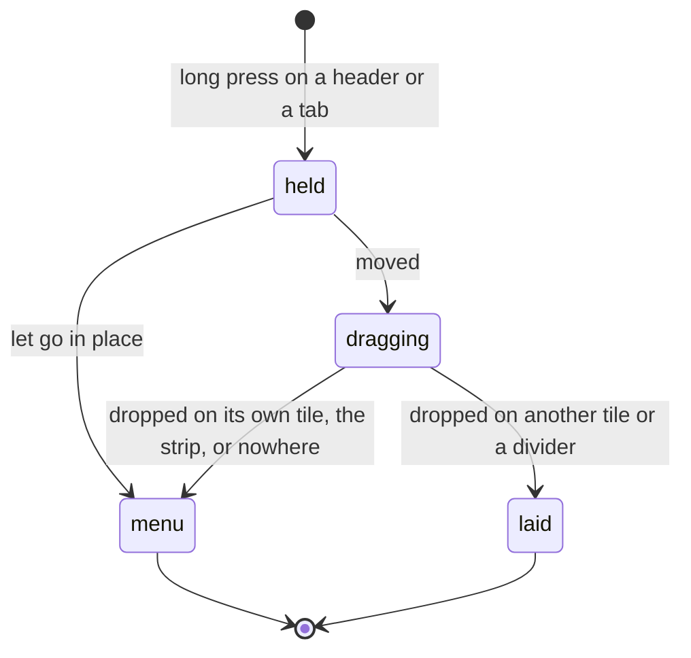

# Feature: a drag that changes nothing opens the pane menu

> Status: approved by the owner on 2026-11-11, written the same day from the owner's request in the console
> ("for android client, also make that when drag is activated but
> dropped in the same place, context menu should be activated, same
> like long press"). The same round
> moves the browser's double-click zoom to the headers (the core's plan
> `2026-11-11-header-zoom.md`); the phone already zooms from the header
> alone, so nothing changes there.

## 1. Goal

A tile's header or a tab, held and let go in place, opens the pane menu
(*open beside*, *later*, *share*, ...). Held and moved, it drags, and
the drop swaps, splits or lays the pane out. Between the two is a drag
that goes nowhere: the finger moved, the header travelled, and it was
let go on its own tile, on the strip, on the key row, or anywhere no
tile or divider takes it. Today that does nothing, and the owner, who
meant the hold, has to hold again. After this change such a drag opens
the pane menu where it started, as the hold does.

Out of scope: a drop on another tile or a divider, which lays the pane
out as before; a tab dropped on the tile its pane is open in, which
also changes nothing and so opens the tab's menu.

## 2. Design

The transfer a header or a tab starts (`DragAndDropTransferData`)
carries a `localState`: the pane's address and whether a tile's header
or a tab started it. The view's root gains a drop target that takes
every pane drag but no drop (`onDrop` returns false) and reads the end
of the session: `onEnded` with the Android event's `result` false means
nothing took the drop, and the menu opens at the source, the tile's
(`headerMenu`) or the tab's (`tabMenu`). A tile's own target returns
false for its own pane, so a self-drop ends the same way. The header of
a tile alone is no drag source, since there is nothing to drop it on;
its hold opens the menu when the finger lifts, moved or not. Everything
else about the drag stands: the hold without a move opens the menu at
once, a drop another tile or a divider takes keeps its result.

## 3. Protocol and API changes

None.

## 4. Security analysis

None: a gesture's end, read inside the app from a drag the app
started. The `localState` never leaves the process and is never read
from a drag another app started (the MIME check stands).

## 5. Privacy check

The instrumented test runs against the test hub with the fixtures'
hosts and names.

## 6. Test plan

| # | Test | Kind | Expected |
|---|------|------|----------|
| 1 | `FlowTest`: a header dragged a little and let go on its own tile | UI | the pane menu opens; back closes it; screenshot `drag-in-place` |
| 2 | `FlowTest`: a tab dragged and let go on the strip | UI | the tab's menu opens |
| 3 | `FlowTest`: a tab dropped on a tile (the existing drop test) | UI | still lays the pane out; no menu |

## 7. Documentation

`docs/features/pane-view.md` (the tab's hold, the arrangement's drag,
the pane menu), `docs/features/notifications.md` (parking's hold), and
the core's `docs/ui-guideline.md` (the Android column of the *pick
several*, *later* and *swap* rows).

## 8. Implementation steps

1. The `localState` on both sources; the root target; the tile's
   target refuses its own pane.
2. The `FlowTest` steps.
3. Docs here and the guideline's rows in the core.

---

## Review (after implementation)

- [x] Diff matches the plan, deviations explained here
- [x] Security rules (AGENTS.md section 2) hold
- [ ] Privacy check passed: `scripts/prepush-check.sh` clean and diff read
- [x] Docs and diagrams updated

## Test run

The full suite without the UI run, 379 tests, 0 failed, on the working
tree over `8fed935` ([#114](https://github.com/notmarkopadjen/muxway-android/issues/114),
`20261111-095005-8fed935`); the secret search found nothing. This
machine has no `adb` and no emulator, so the instrumented steps wait
for a device (`ui-skipped.txt`), as the pull request says; the build
goes to the owner's phone for the check by hand.
