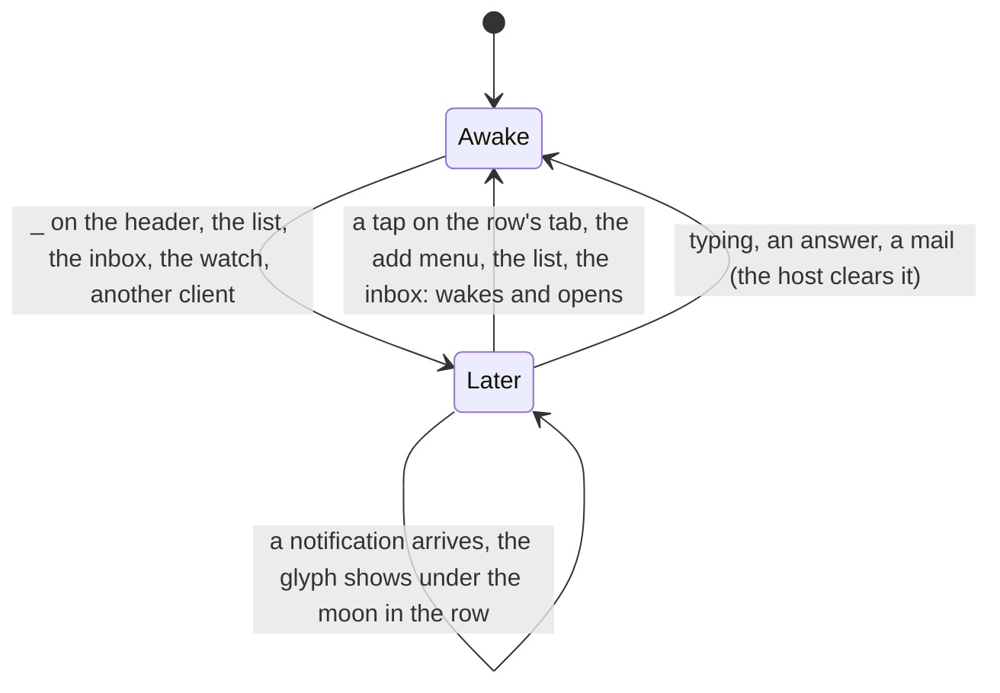

# Feature: minimise is later

> Status: approved by the owner on 2026-11-11 in the console, with the
> core's plan of the same name ("I want to merge minimization and
> *later*. They are basically the same thing, and I don't need both. So,
> on pane there should be only *minimize* button, not *later* moon in
> toolbar. But we should retain the moon icon even though the pane is
> below the main pane, as on the list it's very useful to have this
> icon. Do this for all clients"). The core's plan has the hub's side
> (the desk drops `minimised`) and the browser's.

## 1. Goal

The phone has two ways to put a pane out of the way: *later* in the
pane menu (a tab or a header held), the host's mark every client sees,
and `_` on a header, which moves the tile to the minimised row and
writes the row into the desk. They mean the same thing to the owner.
After this change there is one state, later, and `_` is the way into it
on a tile: the pane is parked on its host and its tab leaves the strip
for the row above the keys, which is the panes the listing says are
parked, on every client at once, whichever client, script or tool
parked it. A tap on the row's tab wakes the pane and brings it back as a
tile. The pane menu loses *later* and *wake* on tabs and headers; the
watch's reply menu keeps them (the watch has no tiles). The moon stays
on the row's tab, the list's row, the inbox and a reader's header.

Out of scope: a client-side hide for a pane the token cannot park (a
reader's, or one on a host whose agent is older than the mark): `_` is
dim there, as *later* was, and the reader sees the row and the marks.

## 2. Design

- **The row is the listing's.** `ViewScreen` drops `parked` and the
  row's settling; `minimised` is `model.panes.filter { it.later && it.key
  !in addresses }`, oldest parking first (`laterAt`, then key). The view's
  `addresses` are its tiles alone. `MinimisedRow` paints each tab from
  the listing's pane (`☾`, the name, the glyph of what waits underneath
  dimmed) and polls nothing of its own; a tap wakes the pane
  (`model.wake`) and adds it as a tile, focused (`model.addPane`, the
  focused tile's place with four open), as the add menu's pick does.
- **`_` parks.** `minimise(key)`: `model.later(key, true)` and the tile
  leaves as a closed one; the last tile makes way as before (the next
  pane of the strip takes it, or the view goes to the list with a
  `list` desk that carries `order` alone). `_` is dim where the pane
  cannot be parked (read-only, or `hostParks` false).
- **A parked tile leaves.** A listing that says a tile's pane is later
  takes the tile out when the tile was seen awake (another client, the
  inbox, a script or the MCP tool parked it); a tile never seen awake
  was opened parked and is woken instead (a writer's, on a host that
  parks); a reader's parked tile stays, with the mark, as today.
- **The desk** loses `minimised`: `Desk`, `Desks.body`, `Desks.words`,
  `Json.desk` (which ignores the field from an older hub) and
  `Json.deskBody`; `AppModel.Opening` and `openDesk` carry tiles alone;
  the follower applies the panes and the arrangement.
- **The pane menu** loses *☾ later* / *☾ wake*; `PaneMenu`'s doc says
  so. The watch's menu is unchanged.
- The swipe's order keeps leaving parked panes out (they are the
  row's); the add menu's *four open* counts tiles alone.

## 3. Protocol and API changes

None beyond the core's: the desk no longer answers `minimised` and
drops one sent; the phone sends none and reads none.

## 4. Security analysis

Minimise is the later write, under the write grant on a writable pane
of a host that parks, checked by the hub and the agent as today; a
reader's `_` is dim and a forged request is refused with `403`. The row
is built from the listing the token may read. Nothing new is logged.

## 5. Privacy check

Docs and tests use `alice-laptop`, `work`, `ask`; screenshots from the
UI run only.

## 6. Test plan

| # | Test | Kind | Expected |
|---|------|------|----------|
| 1 | `Json.desk` with `minimised`; `Json.deskBody` of a desk | unit | the field ignored; never written |
| 2 | `Desks.words` of a `list` desk and of a panes desk | unit | no *minimised* count |
| 3 | `AddMenu.rows` with four tiles and a parked pane | unit | *four open* by the tiles alone; the parked pane under its rule |
| 4 | `_` on a tile among two | UI (`FlowTest`) | the pane `later` in the listing, the row has its tab with `☾`, the tab gone from the strip; the row tapped wakes it and brings the tile back; screenshots `minimised`, `restored` |
| 5 | the last tile minimised; the row shown on a pane opened from the list; the row's tab tapped | UI | the next pane takes the tile; the row comes from the listing; two tiles |
| 6 | the pane menu on a header | UI | no *later* row |

The UI run needs a device; this machine has none, so the run is recorded
with `MUXWAY_UI=0` and says so.

## 7. Documentation

`docs/features/pane-view.md` (the row, `_`, the pane menu, the swipe),
`docs/features/desk.md` (what the desk holds, the sequence diagram),
`docs/features/notifications.md` (*Later*: parking and waking),
`README.md`.

## 8. Implementation steps

1. Protocol module: `Desk`, `Desks`, `Json`, `AddMenu`; unit tests.
2. `AppModel`: `Opening`, `openDesk`.
3. `ViewScreen`: the row from the listing, `_` parks, a parked tile
   leaves, the tap wakes; `PaneMenu`.
4. `FlowTest`; docs. Run (`MUXWAY_UI=0`), record, pull request.

---

## Review (after implementation)

- [x] Diff matches the plan, deviations explained here
- [x] Security rules (AGENTS.md section 2) hold: minimise is the later
      write the hub and the agent check as before; a reader's `_` is dim
      and the row is the listing the token may read
- [x] Privacy check passed: `scripts/prepush-check.sh` clean and diff read
- [x] Docs and diagrams updated

Deviations:

- The hub's `list` desk (merged in #115 while this was written) keeps
  `order` alone; `Json.deskBody` writes no `minimised` for it either.
- A wake asked for is remembered (`waking`) until the listing shows the
  pane awake, so a parked pane brought back from the row is not woken
  twice by the effect that wakes a pane opened parked.
- The row's tabs carry `minimised:<address>` test tags, which the UI test
  uses; the row itself keeps `minimised`.

## Test run

The full suite without the UI run, 379 tests, 0 failed, on `e08b310`
against a hub built from the core's `minimise-is-later` branch
([#117](https://github.com/notmarkopadjen/muxway-android/issues/117),
`20261111-130126-e08b310`); the secret search found nothing. This
machine has no `adb` and no emulator, so the instrumented steps wait for
a device (`ui-skipped.txt`), as the pull request says.
