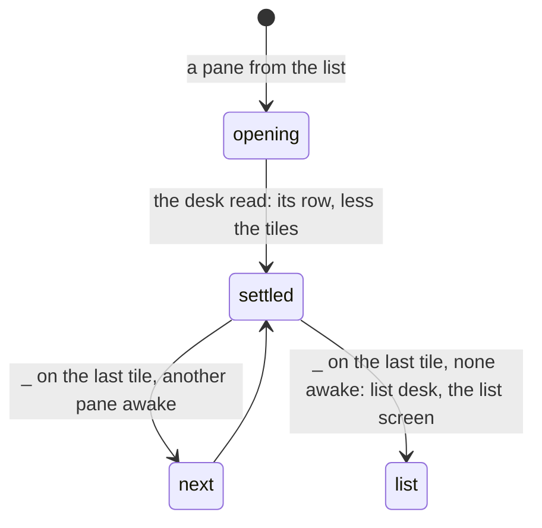

# Feature: the minimised row is the desk's, and the last tile minimises too

> Status: approved by the owner on 2026-11-11 in the console; written the same day from the owner's reports in the console
> (the last tile that cannot be minimised; the minimised row that
> "sometimes resets"). The core's plan of
> the same name has the hub's `list` desk and the browser's side.

## 1. Goal

The phone's minimised row (`parked`) starts empty unless the view was
opened from the list's `desk` row, and the view writes its desk half a
second after it opens. A pane opened from the phone's list therefore
writes a desk without the row, and every client follows it: the row
the owner made on the browser is gone. After this change a view that
opens without an opening of its own takes the hub's row, less the tiles
it opens, and writes nothing before the desk is read once.

`_` is off on the last tile. The owner wants it on: the next pane of
the strip takes the tile and the minimised one joins the row; with no
other awake pane the pane joins the row and the app goes back to the
list, with the desk saying so (`view: "list"`, the core's protocol
change).

## 2. Design

- **The row settles.** `ViewScreen` keeps `parked`; a view without a
  taken opening (`kept.opening == null`) and without a saved state has
  it *unsettled*. When the hub's desk is known (`deskAsked`), it settles
  to the desk's `minimised` (its keys on this hub) less the tiles, or
  empty for a `window` or `list` desk without a row; the write effect
  (`model.writeDesk`) skips until then.
- **The last tile.** `minimise(key)` with one tile: the next pane of
  `order` that is not `key` and not minimised takes the tile
  (`model.open(Screen.View(listOf(next) + minimised + key))` with
  `parked = minimised + key` carried as an opening); with none,
  `model.writeDesk(hub, Desk(view = "list", minimised = ..., order =
  ...))` goes at once and `model.open(Screen.Panes)` follows. The
  header's `_` is enabled on the last tile.
- **`Desk`** (`protocol/Desks.kt`) parses and writes `view: "list"`;
  `openDesk` with a `list` desk opens nothing, as with no panes today;
  the list's desk row says *desk · the list*.

## 3. Protocol and API changes

None beyond the core's `list` desk, which this client reads and writes.

## 4. Security analysis

None: which panes a view shows as minimised, from the desk the token
may read; the token's grants still govern every read of them.

## 5. Privacy check

The instrumented test uses the fixtures' hosts; screenshots are of the
test environment.

## 6. Test plan

| # | Test | Kind | Expected |
|---|------|------|----------|
| 1 | `DesksTest`: a `list` desk parsed and written | unit | round trip; `panesOf` empty |
| 2 | `FlowTest`: a tile minimised, the view left and a pane opened from the list | UI | the row shows the minimised pane; screenshot `row-kept` |
| 3 | `FlowTest`: `_` on the last tile with another pane awake | UI | the other pane is the tile, the row has the first |
| 4 | `_` on the last tile with no other pane awake | UI (the core's spec 129) and unit | the list desk round-trips here (`DeskTest`); the flow itself is the browser's spec 129, since the instrumented run has no way to park every other pane of the test hub |

## 7. Documentation

`docs/features/pane-view.md` (the minimised row, `_`), `docs/features/desk.md`
if present; the core's `docs/ui-guideline.md` rows.

## 8. Implementation steps

1. `Desk` with `list`; the unit test.
2. The row settles from the desk; the first write waits.
3. `_` on the last tile.
4. `FlowTest` steps; docs.

---

## Review (after implementation)

- [x] Diff matches the plan, deviations explained here
- [x] Security rules (AGENTS.md section 2) hold
- [ ] Privacy check passed: `scripts/prepush-check.sh` clean and diff read
- [x] Docs and diagrams updated

## Test run

The full suite without the UI run, 379 tests, 0 failed, on the working
tree over `8fed935` ([#114](https://github.com/notmarkopadjen/muxway-android/issues/114),
`20261111-095005-8fed935`); the secret search found nothing. This
machine has no `adb` and no emulator, so the instrumented steps wait
for a device (`ui-skipped.txt`), as the pull request says; the build
goes to the owner's phone for the check by hand.
