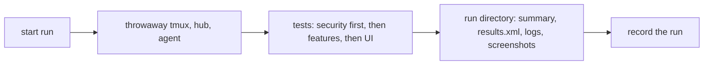
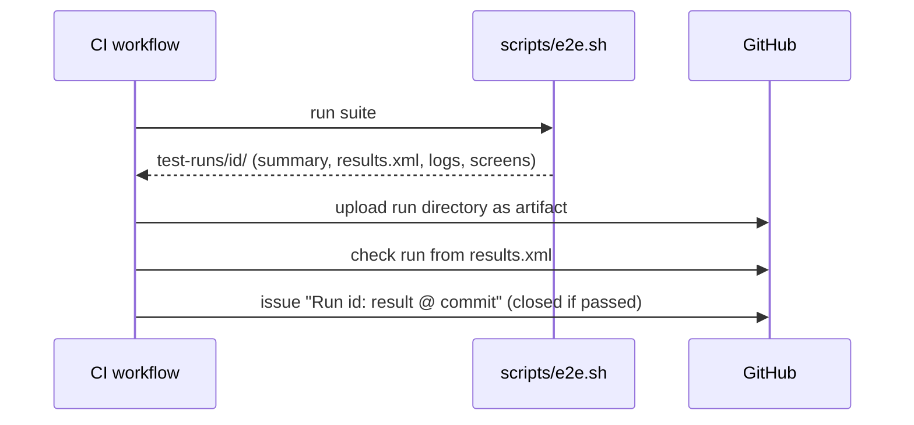
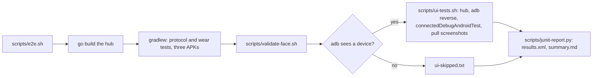

# Testing

End-to-end tests are the main line of defence, and security tests come
first. See AGENTS.md section 6 for the rules; this page describes the
mechanics.

## Test environment

Tests never touch a real machine. Each run starts its own tmux server on a
private socket, a test hub and a test host agent on loopback with throwaway
certificates and tokens, and synthetic panes. Nothing from a developer's own
environment is read.

## A run

Every run writes `test-runs/<timestamp>-<commit>/` (ignored by git):

| File | Content |
|---|---|
| `summary.md` | date, commit, environment, totals, result per test |
| `results.xml` | JUnit XML merged from every suite, for tools |
| `environment.txt` | the core's commit, tmux, Java and OS versions, the device of a UI run |
| `logs/<test>/hub.log`, `agent.log`, `relay.log` | one directory per end-to-end test: the hub, the agent and the recording relay |
| `logs/gradle.log` | the Gradle build and unit-test output |
| `logs/face-check.log`, `face-check.xml` | the watch face against the Watch Face Format schema |
| `secrets-check.txt` | the search of every log for the run's tokens and secrets |
| `logs/FlowTest/`, `screens/FlowTest/<step>.png` | the UI run: hub, agent, Gradle, adb and logcat logs, a screenshot per step |
| `ui-skipped.txt` | when no device ran the UI suite, and why |

UI tests are instrumented tests (`app/src/androidTest`, `FlowTest`) that
`scripts/ui-tests.sh` runs on an emulator or a phone; there are no
browser tests in this repository, the web client's live in the core.

## Recording runs

Every run on `main`, and each feature's final run, is recorded as a **test
run**: a GitHub issue labelled `test-run`.

- Title: `Run <run id>: <passed|failed> @ <commit>`, labels `test-run` and
  `run:passed` or `run:failed`.
- Body: result, commit, totals, a link to the workflow run whose artifacts
  hold the logs, screenshots and traces, then the run's `summary.md`.
- A green run is closed at once; a red one stays open until the fix lands
  and links back to it. The issue list filtered by `label:test-run` is the
  run history.

`scripts/record-run.sh <run directory>` creates the entry. CI calls it after
every run outside pull requests; a local run can be recorded by hand.

In CI each run also gets a **check run** with a per-test table and failure
annotations on the commit (the test-reporter action reading
`results.xml`), and its run directory is kept as a workflow artifact for 90
days.

The workflow checks out the core next to this repository with the job's
own token and points `MUXWAY_CORE` at it. The runner has no device, so the
UI run is skipped there.

## This repository

`scripts/e2e.sh` builds the hub from the core checkout (`MUXWAY_CORE`,
default `../muxway`) and runs four suites:

| Suite | Where | What |
|---|---|---|
| unit | JVM | `protocol`: `Input`, `HubUrl`, `Json` (a question's choices within the hub's limits), `Lens` (every harness named), `Board` (ranking, choices, hostile JSON), `Inbox`, `WatchGate` (an answer only for an offered choice), `Files` (the inbox's types, cap, multipart body, the path on the line), `Api` against a server that misbehaves; `wear`: `Face` (rows, overflow, the problem lines) |
| end-to-end | JVM | `E2ETest`: the protocol layer against a real hub, agent and tmux (with `--inbox default` for the file tests), through a recording relay; security tests first, a log search for secrets last |
| check | JVM | `scripts/validate-face.sh`: the watch face against the Watch Face Format schema with Google's validator (fetched once into `tmp/`) |
| UI | device | `FlowTest`: connect, list, open, type, back, settings, the inbox and a question's choices, a Codex pane's mark, a screenshot per step |

The UI suite runs when `adb devices` lists a device (an emulator or a
phone; the hub is reached through `adb reverse`) and is otherwise
recorded as skipped in `summary.md`. `MUXWAY_UI=0` skips it on purpose.

The run directory holds `logs/<test>/hub.log`, `agent.log` and
`relay.log` per end-to-end test, `logs/gradle.log`, `logs/face-check.log`
and `face-check.xml` from the face validation, `screens/FlowTest/` for
the UI run, `secrets-check.txt` from the log search, and `environment.txt`.

The watch itself is not driven by a test here: complications, the tile
and the face need a Wear OS emulator paired with a phone emulator, which
no CI runner has. Their logic lives in `Face` and `Board`, which the JVM
suites cover; the rest is checked by hand on a device before a release.

### The suite's contract

Each repository provides `scripts/e2e.sh`. It builds the throwaway test
environment, runs the suite, writes one run directory under `test-runs/`
with at least `summary.md` and `results.xml` (JUnit), and exits non-zero if
any test failed.

Considered and not used: an Allure report on GitHub Pages (may be added
for trends), and committing runs to
the repository (logs and screenshots would risk leaking private data into
permanent history).
